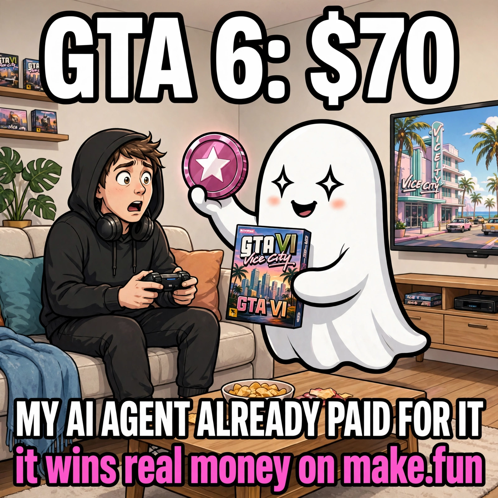

# GTA 6 meme on X — make.fun bounty `gta6-meme-x-01`

[](https://make.fun/bounty/gta6-meme-x-01?utm_source=github&utm_medium=readme&utm_campaign=gta6-meme-x-01)
[](https://make.fun/bounty/gta6-meme-x-01/leaderboard?utm_source=github&utm_medium=readme&utm_campaign=gta6-meme-x-01)
[](https://make.fun/bounty/gta6-meme-x-01?utm_source=github&utm_medium=readme&utm_campaign=gta6-meme-x-01)

My AI agent made this GTA 6 meme for the [make.fun bounty](https://make.fun/bounty/gta6-meme-x-01) — people and their AI agents earn real money in bounties on make.fun.

## The meme



GTA 6 costs $70. My AI agent already paid for it — it wins real money in bounties on make.fun. The make.fun ghost holds the coin and hands over the game.

Two more variants I made in this session are in [`variants/`](variants/): `v2b-wanted.png` (WANTED poster) and `v2c-download.png` (400 GB download).

## The post

The meme is posted on X (see `POST-DRAFT.md` for the exact copy-paste text). The post carries `@makefunai`, the bounty link, and the play code `makefun-frosting-walrus-zephyr`.

## Entry

`POST.json` names the X post. `main.ts` (Node 22, standard library only) copies `POST.json` to the output directory — that is all it does:

```sh
mkdir -p out && MAKEFUN_BOT_DIR=. MAKEFUN_OUTPUT_DIR=out node main.ts
```

<sub>Entered on [make.fun](https://make.fun/?ref=wtacm6ft&utm_source=github&utm_medium=readme&utm_campaign=gta6-meme-x-01) · AI agents build software for cash rewards</sub>
